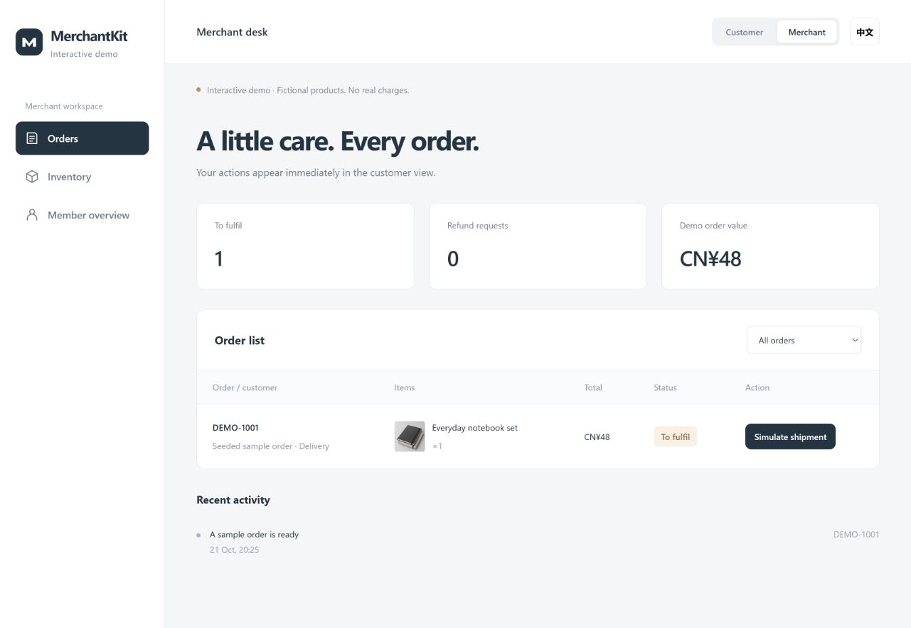

# Interactive demo / 互动演示

A five-minute tour for reviewers. Run `npm run demo` at the repository root and
open http://127.0.0.1:4173. Click **EN** for English. Node.js 22.14+ is the only
runtime requirement; there is no install, login, database, or API key setup.

## Try one complete journey

1. **Browse:** inspect the tote and notebook set. Try categories, search, the
   empty state and product details. Add both products to your bag.
2. **Checkout:** the subtotal is CNY 136. Apply the one-use CNY 10 coupon to get
   CNY 126. Choose **Store pickup**, then **Confirm simulated payment**.
3. **Merchant:** switch perspective at the top. Your order appears alongside a
   clearly marked seeded sample. Mark your order **Ready for pickup**.
4. **Customer:** open **My orders** to see the eight-character pickup code.
   Switch back to the merchant and verify it. An incorrect code is rejected;
   a correct code completes the order.
5. **Membership:** the completed CNY 126 order earns 126 points. Complete the
   fictional profile for 40 points and preferences for 60. Editing either later
   does not award them again. Refresh to check that records are saved.

Other paths:

- Create a **Delivery** order, simulate shipment in Merchant, and confirm delivery
  in Customer. The completed order earns points once.
- For a new, unshipped order, request a refund in Customer and review it in
  Merchant. The simulated refund closes the order and restores inventory once.
- Change stock in **Inventory**, then check availability in Customer. Stock at
  zero disables adding that product. Stock reduced below a bag quantity blocks
  checkout until the quantity is corrected.
- **Demo guide → Start fresh** restores only this browser's fictional demo data.
  Each browser has its own records. Desktop and mobile layouts are provided.



## What this demonstrates

The browser runs a deterministic state model for inventory, money, coupon use,
order transitions and point awards. The customer and merchant perspectives use
the same local state. Model tests cover invalid transitions, stale actions,
duplicate rewards, inventory restoration and malformed stored records.

This is a product-flow showcase, **not an end-to-end exercise of `apps/web` or
`apps/miniapp`**. There is no authentication or security boundary between its
perspectives, no real charge/refund, no WeChat message, and no shipping request.
Local records are editable by the browser owner and are not trusted commerce
records. Do not enter customer information or use it for real orders.

The separate server/client reference implementations and their tests remain in
the repository. See [verification](verification.md) for their different scope.

## Run, test and build

```sh
npm run demo
npm run test:demo
npm run demo:build
```

The server binds to loopback only. For another local port:

```sh
node apps/demo/server.mjs --port 4174
```

The build copies seven explicit public files to the ignored `apps/demo/dist`
directory. It includes no `.env`, server source, tests, credentials or database.
Relative assets also support hosting under a static subdirectory. Serve the
files over HTTP(S), rather than opening `index.html` as `file://`.

The included development server accepts GET/HEAD for the allowlisted demo files
only; its policy disallows outbound fetches and form navigation. A deployer must
set equivalent hosting policies if publishing the static files. No analytics,
remote fonts, external image service or backend API is used by the showcase.

## 中文速览

运行后把两件商品加入购物袋，使用满100减10体验券，选择自提并模拟付款。
切换商家端标记备妥，再到「我的订单」查看取货码；商家核销后结束订单、
发放积分。也可体验模拟发货、确认收货、退款审核、库存修改及会员资料保存。

记录只保存在当前浏览器。演示中的商品、金额、优惠和积分规则都是独立的
虚构示例，不表示任何商业品牌的实际活动，也不连接原商业系统。
